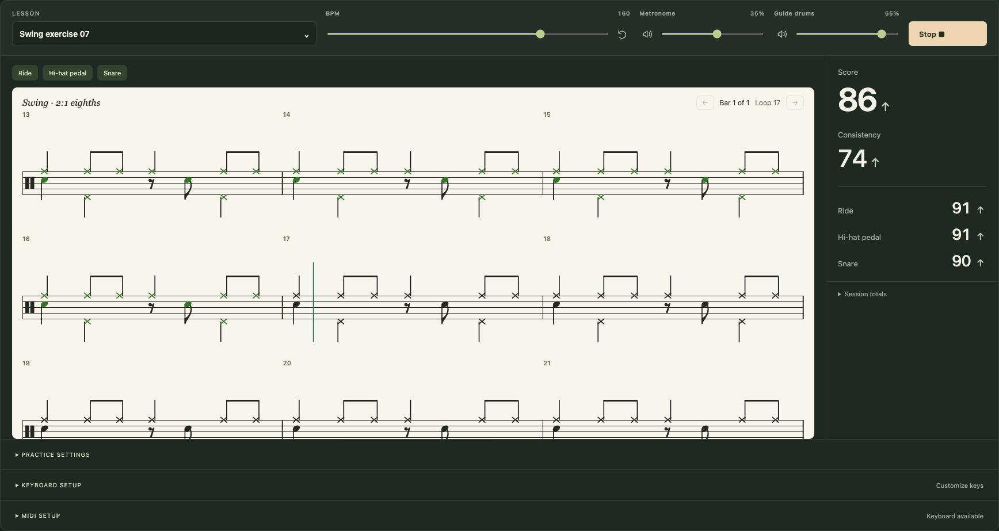
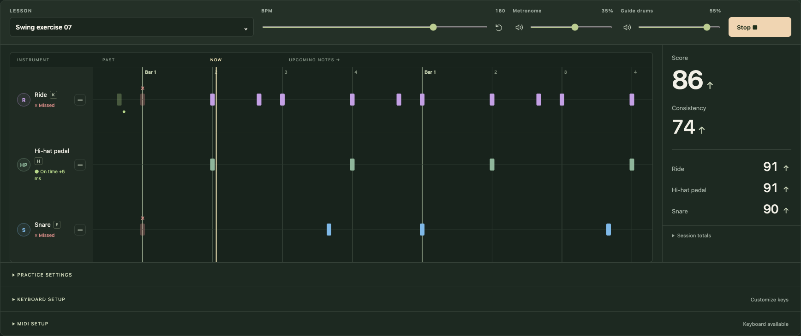

# Rhythm Trainer

Practice your timing. Read the groove. See your progress.

[**Open the trainer →**](https://gaeevy.github.io/rhythm-trainer/) · [Documentation](docs/README.md)

[](https://github.com/Gaeevy/rhythm-trainer/actions/workflows/pages.yml)

A browser-based drum-practice app for the **Millenium MPS-850**, built for
**Chrome on macOS**. Play with MIDI or a keyboard, loop custom JSON lessons,
and follow your timing with recorded guide drums and a metronome.



**Read** standard drum notation with swing and triplets. **Practice** selected
pads at your tempo. **Track** weighted scores, per-pad trends and how tightly
simultaneous hits land together.

<details>
<summary>Prefer scrolling lanes? View the alternative practice layout.</summary>



</details>

Screenshots show a demo session with simulated input.

The app runs entirely in the browser. Plain JavaScript, HTML and CSS; no account,
backend, frontend framework or runtime CDN. Python handles local serving and
static packaging for GitHub Pages.

## Run locally

```sh
python3 scripts/site.py
```

Open [localhost:8000](http://localhost:8000) in Chrome. Choose a lesson and press
**Start loop** or **Space**. Connect the kit's USB MIDI port to use the pads.

## Documentation

Start with the [documentation index](docs/README.md).

- [Practice guide](docs/practice.md) — controls, MIDI, timing and sound.
- [Lesson format](docs/lessons.md) — add one JSON file, including Swing/triplets.
- [Development](docs/development.md) — setup, architecture, checks and deployment.
- [Project history](docs/history/README.md) — dated summaries of completed work.
- [AGENTS.md](AGENTS.md) — instructions for coding agents.

Audio and notation credits/licenses stay beside their assets:
[drum recordings](assets/drums/README.md), [VexFlow and fonts](assets/vendor/vexflow/README.md).
